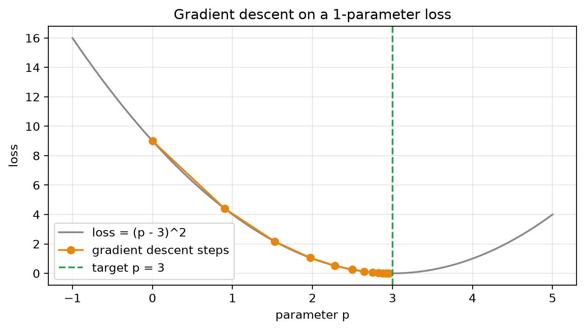
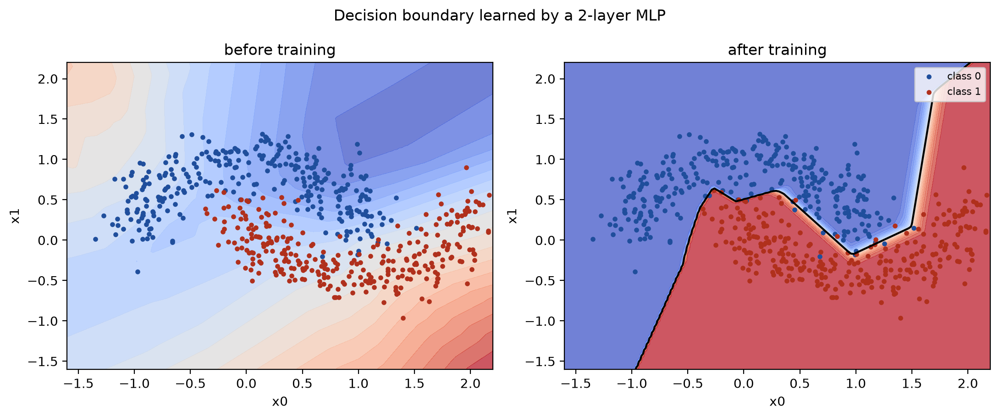
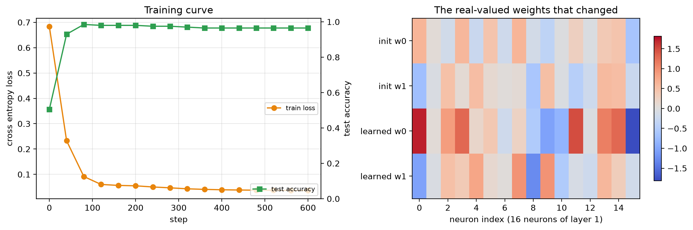

<!-- このファイルは scripts/build_tutorials.py が自動生成しています。
     直接編集せず、examples/24_nn_basics.py を編集して再生成してください。 -->

**機械学習をやったことがない人のための最初の1本。** このページに DLGN は出てこない。
テンソル → 自動微分 → `nn.Module` → 学習ループ、という PyTorch の全体像を
2次元のトイデータ(直線では分けられない三日月2つ)の分類で一周する。

主題は精度ではなく「**学習とは何をしていることなのか**」を目で見ること。
1パラメータの損失を勾配降下で下る図、学習前後の決定境界、そして
**動いた実数の重みそのもの**の3枚で、NN が実数の世界に住んでいることを確かめる。

:::note[このページについて]
所要時間の目安: **約8分** / 実行環境: CPU のみ(GPU 不要)
元スクリプト: [`examples/24_nn_basics.py`](https://github.com/tsukushi-gate/Griffith/blob/main/examples/24_nn_basics.py)
手元で試す: [`notebooks/24_nn_basics.ipynb`](https://github.com/tsukushi-gate/Griffith/blob/main/notebooks/24_nn_basics.ipynb)(このページと同じ内容の未実行ノートブック。`uv run --group docs jupyter lab notebooks/` で開ける)
コード出力はすべて **実際に実行した結果**をそのまま埋め込んでいます。
:::

<!-- Colabバッジ: リポジトリ public 化後、この span を data-colab-url を href に
     持つ <a> へ差し替えると「Colabで開く」が有効になる。 -->
<span class="colab-badge" data-colab-url="https://colab.research.google.com/github/tsukushi-gate/Griffith/blob/main/notebooks/24_nn_basics.ipynb">▶ Colabで開く(リポジトリ公開後に有効化)</span>

ニューラルネットとは何か ── PyTorchの基礎をゼロから(入門コース 1/3)。

**このページは「機械学習をやったことがない人」のための最初の1本**である。
DLGN(微分可能論理ゲートNN)の話は一切出てこない。ここでやるのは、
普通のニューラルネット(NN)を PyTorch で書いて動かし、
**「学習とは何をしていることなのか」**を自分の目で見ることだけ。

扱うのは次の4つで、これがそのまま PyTorch の全体像になる。

1. **テンソル** ── NN が扱う数の入れ物(表計算のセルが多次元になったもの)
2. **自動微分** ── 「どっちへ動かせば正解に近づくか」を PyTorch が勝手に計算してくれる仕組み
3. **nn.Module** ── 層を組み合わせてモデルを作る書き方
4. **学習ループ** ── 予測 → 誤差 → 修正 を何百回も回す、たった5行の型

題材は2次元のトイデータ(三日月が2つ噛み合った形。直線では分けられない)の分類で、
**決定境界がぐにゃりと曲がっていく様子**と、そのとき裏で
**実数の重みがどう変わったか**を並べて見る。

実行: uv run python examples/24_nn_basics.py
期待結果: test accuracy 0.95 以上(2層の小さな MLP・CPUで数秒)

次の1本 examples/25_pytorch_mlp.py では、同じ書き方のまま手書き数字(MNIST)へ、
その次の examples/26_mlp_to_dlgn.py で**同じ問題を論理ゲートへ置き換える**。

## 準備: このページで使う道具

使うのは PyTorch(`torch`)と作図の matplotlib だけ。DLGN のライブラリは
このページでは一切登場しない ── まず**普通のニューラルネット**を一周する。

- `torch` … テンソル(多次元の数の並び)と自動微分を提供する本体
- `torch.nn` … 層(`nn.Linear` など)とモデルの組み立て方
- `torch.nn.functional`(`F`) … 損失関数など、状態を持たない関数群

```python
import copy
import math

import matplotlib.pyplot as plt
import torch
import torch.nn as nn
import torch.nn.functional as F
```

学習の結果は乱数に依存する。**重みの初期値**(層が持つ数の出発点)も、
**データのノイズ**も乱数から作られるので、種を固定しないと実行のたびに数字が変わり、
「コードを直したから変わったのか、乱数で変わったのか」が区別できなくなる。

```python
# 乱数を固定する。重みの初期値もデータのノイズも乱数なので、
# 固定しないと実行のたびに結果が変わる(再現性のための儀式)。
torch.manual_seed(0)
```

## テンソル: NNが扱う数の入れ物

**テンソル**とは多次元の数の並びのことで、NN の計算はすべてこの上で行われる。
0次元=スカラー、1次元=ベクトル、2次元=行列、と次元が増えていく。

ここでは「3サンプル × 2特徴」の入力 `x`、「2特徴 → 1出力」の**重み** `w`、
出力をずらす**バイアス** `b` を手で置き、NN の1層が何をしているのかを
`x @ w + b`(行列積 + 足し算)の1行で確かめる。層の実体はこれだけである。

### テンソルを作って掛けて足す

```python
# テンソルは「多次元の数の並び」。0次元=スカラー、1次元=ベクトル、2次元=行列。
# NumPy の配列とほぼ同じだが、GPU に載せられて、後述の自動微分が付いてくる。
x = torch.tensor([[1.0, 2.0],
                  [3.0, 4.0],
                  [5.0, 6.0]])   # 3サンプル × 2特徴
w = torch.tensor([[0.5],
                  [-1.0]])       # 2特徴 → 1出力 の「重み」
b = torch.tensor([0.1])          # 下駄(バイアス)
print(f'x.shape={tuple(x.shape)}  w.shape={tuple(w.shape)}')
```

```text title="出力"
x.shape=(3, 2)  w.shape=(2, 1)
```

`@` は行列積の演算子。1行目の答えは $1.0 \times 0.5 + 2.0 \times (-1.0) + 0.1 = -1.4$ で、
手計算と一致する。**掛けて足すだけ**が層の中身であり、
学習とは「この `w` と `b` の値を良いものに変えること」に他ならない。

```python
# NN の計算の実体は、この「掛けて足す」(行列積)だけ。
# 1行目は 1.0*0.5 + 2.0*(-1.0) + 0.1 = -1.4 になる。
print(f'x @ w + b =\n{x @ w + b}')
```

```text title="出力"
x @ w + b =
tensor([[-1.4000],
        [-2.4000],
        [-3.4000]])
```

## 自動微分: どちらへ動かせばよいかを機械に計算させる

良い `w` を人手で探すのは不可能なので、機械に「どちらへ動かせば良くなるか」を
計算させる。その情報が**勾配**(gradient)で、「そのパラメータを少し増やすと
損失がどれだけ増えるか」を表す1つの数である。

ここでは最小の例として、パラメータ $p$ 1個だけの損失
$\mathrm{loss} = (p-3)^2$ を使う。$p=3$ で最小になる、ただの2次関数である。
`requires_grad=True` を付けたテンソルは計算の履歴を覚えており、
`loss.backward()` を呼ぶと勾配が `p.grad` に入る。

### 勾配を1つ計算してみる

```python
# requires_grad=True を付けたテンソルは、そこから計算された値をたどって
# 「この数を少し動かすと結果がどれだけ変わるか」(= 勾配)を後から求められる。
p = torch.tensor(0.0, requires_grad=True)
loss = (p - 3.0) ** 2            # p が 3 に近いほど小さくなる、ただの2次関数
loss.backward()                  # 勾配を計算して p.grad に入れる
```

手で微分すると $\frac{d}{dp}(p-3)^2 = 2(p-3) = 2(0-3) = -6$。
自動微分が返す値もこれと一致する ── PyTorch は魔法ではなく、
連鎖律を機械的に適用しているだけだと確認できる。

```python
# 手計算すると d/dp (p-3)^2 = 2(p-3) = 2*(0-3) = -6。同じ値が入っている。
print(f'\nloss={loss.item():.1f}  dloss/dp={p.grad.item():.1f}')
print('勾配が負 = p を増やせば損失が減る、という向きの情報')
```

    
```text title="出力"
loss=9.0  dloss/dp=-6.0
勾配が負 = p を増やせば損失が減る、という向きの情報
```

### 勾配降下: 勾配の逆向きへ少しずつ進む

勾配が分かれば、あとは**その逆向きへ少しずつ動かす**だけでよい。これが
**勾配降下法**で、更新式は $p \leftarrow p - \eta \cdot \frac{d\mathrm{loss}}{dp}$。
$\eta$(コード上の `lr`)は**学習率**、つまり一歩の大きさで、
大きすぎると谷を飛び越えて発散し、小さすぎるといつまでも着かない。

逆向きに進むのは、勾配が「増やすと損失が増える向き」を指しているため。
損失を**減らし**たいのだから、符号を反転させる必要がある。

```python
# 学習の正体はこれだけ。「傾きを測って、坂の下る方へ一歩進む」を繰り返す。
# lr(学習率)が一歩の大きさで、大きすぎると行き過ぎ、小さすぎると進まない。
lr = 0.15
p = torch.tensor(0.0, requires_grad=True)
trajectory = [p.item()]
for _ in range(12):
    loss = (p - 3.0) ** 2
    loss.backward()
    with torch.no_grad():        # ここは学習の更新なので微分の記録は要らない
        p -= lr * p.grad         # 勾配の「逆」向きへ進む
    p.grad = None                # 勾配は積み上がるので毎回消す
    trajectory.append(p.item())
print('\np の軌跡: ' + ' → '.join(f'{v:.2f}' for v in trajectory[:6]) + ' → ...')
print(f'12ステップ後: p={trajectory[-1]:.4f}(正解は 3.0)')
```

    
```text title="出力"
p の軌跡: 0.00 → 0.90 → 1.53 → 1.97 → 2.28 → 2.50 → ...
12ステップ後: p=2.9585(正解は 3.0)
```

### 図1: 勾配降下が谷を下りていく様子

灰色の曲線が損失 $(p-3)^2$、橙の点が各ステップでの $p$ の位置である。
12ステップぶんの点が谷底(緑の破線 $p=3$)へ吸い込まれていく様子を見る。

```python
# 曲線が損失、点が各ステップでの p の位置。右へ行くほど谷底(=正解)に近づく。
# これが「学習」の最小単位で、NN ではこの p が数万〜数億個あるだけ。
grid = torch.linspace(-1.0, 5.0, 200)
fig, ax = plt.subplots(figsize=(7, 4))
ax.plot(grid, (grid - 3.0) ** 2, color='#888888', label='loss = (p - 3)^2')
traj = torch.tensor(trajectory)
ax.plot(traj, (traj - 3.0) ** 2, 'o-', color='#e8850c', label='gradient descent steps')
ax.axvline(3.0, ls='--', color='#2e9e4f', label='target p = 3')
ax.set_xlabel('parameter p')
ax.set_ylabel('loss')
ax.set_title('Gradient descent on a 1-parameter loss')
ax.legend()
ax.grid(alpha=0.3)
fig.tight_layout()
plt.show()
```

    

    

**読み取り**: 点の間隔は谷底に近づくほど狭くなっている。勾配 $2(p-3)$ が
谷底へ近づくほど小さくなり、歩幅 $\eta \cdot 2(p-3)$ も自動的に縮むためである。
「最初は大きく、近づいたら慎重に」という挙動を、誰も明示的に書いていないのに
勾配降下がひとりでに実現している。NN の学習はこの点が数万〜数億個あるだけで、
起きていることは最後までこの図と同じである。

## データセット: 直線では分けられない2クラス

分類問題を1つ用意する。**two moons**(噛み合った三日月2つ)は、
わざと**1本の直線では絶対に分けられない**形にしたトイデータで、
「モデルが曲がった境界を作れるか」を試すための定番である。

直線で分けられる問題なら層を積む必要がない。**層を積む理由**そのものを
見るために、あえてこの形を選んでいる。

```python
# 三日月が2つ噛み合った形(two moons)を自前で作る。
# わざと「1本の直線では絶対に分けられない」形にしてあるのがポイント。
N_PER_CLASS = 300
```

```python
def make_moons(n_per_class, noise=0.18):
    """2つの三日月からなる2クラスのトイデータを作る。"""
    t = torch.rand(n_per_class) * math.pi
    outer = torch.stack([torch.cos(t), torch.sin(t)], dim=1)
    inner = torch.stack([1.0 - torch.cos(t), 0.5 - torch.sin(t)], dim=1)
    points = torch.cat([outer, inner], dim=0) + noise * torch.randn(2 * n_per_class, 2)
    labels = torch.cat([torch.zeros(n_per_class), torch.ones(n_per_class)]).long()
    return points, labels
```

```python
points, labels = make_moons(N_PER_CLASS)
```

### 訓練データとテストデータに分ける

600点のうち400点を**訓練**、残り200点を**テスト**に回す。テストは
学習に一度も使わない問題で、「丸暗記」ではなく「法則を学べたか」を測るために取り分ける。
訓練データだけで測った精度は、暗記でもいくらでも上げられるので指標にならない。

```python
# 学習データとテストデータに分ける。テストは「学習に使っていない問題」で、
# 丸暗記ではなく法則を学べたかを測るために取り分けておく。
perm = torch.randperm(points.shape[0])
train_idx, test_idx = perm[:400], perm[400:]
train_x, train_y = points[train_idx], labels[train_idx]
test_x, test_y = points[test_idx], labels[test_idx]
print(f'\ntrain={tuple(train_x.shape)} test={tuple(test_x.shape)}(2次元入力 / 2クラス)')
```

    
```text title="出力"
train=(400, 2) test=(200, 2)(2次元入力 / 2クラス)
```

## モデル定義: nn.Moduleで層を積む

`nn.Sequential` は「層を上から順に通す」という組み立て方。ここでは
`nn.Linear`(掛けて足す)と `nn.ReLU`(負をゼロにする)を交互に3枚重ねる。

**なぜ ReLU を挟むのか** ── `nn.Linear` は何枚重ねても、合成すると1枚の
`nn.Linear` に潰れてしまう(線形写像の合成は線形写像)。つまり境界は直線のまま。
間に**非線形関数**を1つ挟むだけでこの潰れが止まり、折れ線を継ぎ合わせた
曲がった境界を作れるようになる。ReLU $\max(0, z)$ はその最も安いやり方である。

最後の `nn.Linear(16, 2)` の出力2つは**ロジット**、つまり各クラスの生のスコアで、
大きい方が予測クラスになる。

```python
# nn.Linear(2, 16) は「2入力を16個のニューロンへ、掛けて足す」層。
# 中身は 2x16 の重み行列と 16 個のバイアスで、これが学習で動く数のすべて。
# ReLU は非線形化(負をゼロにする)。これが無いと何層積んでも直線のままで、
# 三日月のような曲がった境界は絶対に作れない。
model = nn.Sequential(
    nn.Linear(2, 16),
    nn.ReLU(),
    nn.Linear(16, 16),
    nn.ReLU(),
    nn.Linear(16, 2),   # 出力2 = クラスごとのスコア(ロジット)
)
print(model)
n_params = sum(p.numel() for p in model.parameters())
print(f'学習される実数パラメータ: {n_params} 個')
```

```text title="出力"
Sequential(
  (0): Linear(in_features=2, out_features=16, bias=True)
  (1): ReLU()
  (2): Linear(in_features=16, out_features=16, bias=True)
  (3): ReLU()
  (4): Linear(in_features=16, out_features=2, bias=True)
)
学習される実数パラメータ: 354 個
```

```python
# 学習前のモデルを取っておく(あとで「学習前後の決定境界」を並べるため)。
model_init = copy.deepcopy(model)
```

## 学習ループ: 予測 → 誤差 → 修正

ここからが学習の本体だが、書くことは4行しかない。しかも**この型はモデルが
何であっても変わらない** ── 入門3で中身を論理ゲートに置き換えても、
このループは1文字も書き換えずに済む。

- `F.cross_entropy` … 分類の定番の**損失**。正解クラスのスコアが他より
  高いほど小さくなる量で、これを下げることが学習の目的になる
- `opt.step()` … 勾配に従って全パラメータを更新する。ここでは
  単純な勾配降下ではなく **Adam**(各パラメータごとに歩幅を自動調整する
  改良版)を使う。手で学習率を詰める手間が減るため、実務ではまずこれを選ぶ

```python
# PyTorch の学習ループは、どんなモデルでもこの5行の型に収まる。
#   1. opt.zero_grad()  前回の勾配を消す
#   2. loss = ...       予測して誤差を測る(cross_entropy = 分類の定番)
#   3. loss.backward()  全パラメータの勾配を自動で計算する
#   4. opt.step()       勾配の逆向きへ全パラメータを少し動かす
# これを何百回も回すのが「学習」。
opt = torch.optim.Adam(model.parameters(), lr=0.01)
history = []
for step in range(601):
    opt.zero_grad()
    loss = F.cross_entropy(model(train_x), train_y)
    loss.backward()
    opt.step()
    if step % 40 == 0:
        with torch.no_grad():
            test_acc = (model(test_x).argmax(-1) == test_y).float().mean().item()
        history.append((step, loss.item(), test_acc))
        print(f'step {step:>4}  loss={loss.item():.4f}  test acc={test_acc:.4f}')

steps, losses, accs = zip(*history, strict=True)
final_acc = accs[-1]
print(f'\n最終 test accuracy = {final_acc:.4f}')
assert final_acc > 0.90, f'test acc={final_acc:.4f} が低すぎる'
```

```text title="出力"
step    0  loss=0.6836  test acc=0.5050
step   40  loss=0.2326  test acc=0.9300
step   80  loss=0.0914  test acc=0.9850
step  120  loss=0.0602  test acc=0.9800
step  160  loss=0.0565  test acc=0.9800
step  200  loss=0.0548  test acc=0.9800
step  240  loss=0.0503  test acc=0.9750
step  280  loss=0.0469  test acc=0.9750
step  320  loss=0.0430  test acc=0.9700
step  360  loss=0.0407  test acc=0.9650
step  400  loss=0.0392  test acc=0.9650
step  440  loss=0.0382  test acc=0.9650
step  480  loss=0.0376  test acc=0.9650
step  520  loss=0.0371  test acc=0.9650
step  560  loss=0.0366  test acc=0.9650
step  600  loss=0.0363  test acc=0.9650

最終 test accuracy = 0.9650
```

## 評価と可視化: 境界はどう曲がったか

**読み取り**: 上のログで loss が単調に下がり、test accuracy が 0.5(=当てずっぽう)から
0.95 以上まで上がっている。「学習が進んだ」とは、この2つの数がこう動いたことを指す。

ただし数字だけでは**どんな境界を引いたのか**が分からない。そこで平面全体に
モデルを当てて、位置ごとの予測を色で塗った図を作る。次の関数はそのための格子を返す。

### 平面全体にモデルを当てるヘルパー

```python
def decision_grid(net, span=2.2, n=160):
    """平面全体にモデルを当て、クラス1である確率のグリッドを返す。"""
    axis = torch.linspace(-1.6, span, n)
    gx, gy = torch.meshgrid(axis, axis, indexing='xy')
    flat = torch.stack([gx.reshape(-1), gy.reshape(-1)], dim=1)
    with torch.no_grad():
        prob = F.softmax(net(flat), dim=-1)[:, 1]
    return axis, prob.reshape(n, n)
```

### 図2: 決定境界は学習で「曲がる」

背景の色は「その位置に点があったらモデルはどちらのクラスと答えるか」で、
赤寄りがクラス1・青寄りがクラス0。黒い実線が**決定境界**(予測が切り替わる線)である。
左が学習前、右が学習後。散布している点は元のデータそのもの。

```python
# 背景の色が「モデルがどちらのクラスだと思っているか」。左は学習前(でたらめ)、
# 右は学習後で、2つの三日月の間をぬうように境界が曲がっている。
# 曲げているのは ReLU で、曲げ方を決めているのが学習された重み。
axis_init, prob_init = decision_grid(model_init)
axis_done, prob_done = decision_grid(model)
fig, axes = plt.subplots(1, 2, figsize=(11, 4.6))
for ax, axis, prob, name in (
    (axes[0], axis_init, prob_init, 'before training'),
    (axes[1], axis_done, prob_done, 'after training'),
):
    ax.contourf(axis, axis, prob, levels=20, cmap='coolwarm', alpha=0.75)
    ax.contour(axis, axis, prob, levels=[0.5], colors='k', linewidths=1.5)
    for cls, color in ((0, '#1f4e9c'), (1, '#b0301c')):
        sel = labels == cls
        ax.scatter(points[sel, 0], points[sel, 1], s=8, c=color, label=f'class {cls}')
    ax.set_title(name)
    ax.set_xlabel('x0')
    ax.set_ylabel('x1')
    ax.set_xlim(-1.6, 2.2)  # 背景を塗ったグリッドの範囲に合わせる
    ax.set_ylim(-1.6, 2.2)
axes[1].legend(loc='upper right', fontsize=8)
fig.suptitle('Decision boundary learned by a 2-layer MLP', fontsize=12)
fig.tight_layout()
plt.show()
```

    

    

**読み取り**: 学習前(左)の境界は乱数任せの直線に近く、三日月をまたいで
真っ二つにしている。学習後(右)は2つの三日月の間をぬうように**曲がっている**。
この曲がりを作っているのが ReLU の折れ目で、どこで折るかを決めているのが
学習された重みである。同じ図を入門3では論理ゲート版で描き直す。

### 図3: 学習曲線と、動いた「重み」そのもの

左は学習の進み方(橙=損失・緑=テスト正解率)。右は1層目の重み行列 $2 \times 16$ を
学習前後で縦に並べたヒートマップで、赤が正・青が負の値を表す。
**上の境界の変化が、右のこの32個の数が動いた結果でしかない**ことを確かめる図である。

**読み取り(先に書いておく)**: 左では損失が単調に下がり、正解率が階段状に上がって
0.95 超で頭打ちになる。右は上2行(学習前)がほぼ均一な薄い色なのに対し、
下2行(学習後)は濃い赤と濃い青がはっきり分かれる ── 各ニューロンが
「$x_0$ が大きいほど反応する / $x_1$ が大きいと抑制される」といった
役割を持ち始めた、ということ。
そして**動いたのは中途半端な実数**であって、0/1 では表せない。
次のページ以降では、この実数の重みが丸ごと**論理ゲートの真理値表**へ置き換わる。

```python
# 左が学習の進み方(損失が下がり、正解率が上がる)。
# 右は1層目の重み行列 2x16 を学習前後で並べたもの。この 32 個の実数が動いただけで
# 上の境界が曲がった ── **NN が学習しているのは実数の重み**、というのがこの図の主張。
w_init = model_init[0].weight.detach().T
w_done = model[0].weight.detach().T
vmax = float(max(w_init.abs().max(), w_done.abs().max()))
fig, axes = plt.subplots(1, 2, figsize=(12, 4))
axes[0].plot(steps, losses, 'o-', color='#e8850c', label='train loss')
axes[0].set_xlabel('step')
axes[0].set_ylabel('cross entropy loss')
axes[0].grid(alpha=0.3)
twin = axes[0].twinx()
twin.plot(steps, accs, 's-', color='#2e9e4f', label='test accuracy')
twin.set_ylabel('test accuracy')
twin.set_ylim(0, 1.02)
axes[0].set_title('Training curve')
axes[0].legend(loc='center right', fontsize=8)
twin.legend(loc='lower right', fontsize=8)
stacked = torch.cat([w_init, w_done], dim=0)
im = axes[1].imshow(stacked, cmap='coolwarm', vmin=-vmax, vmax=vmax, aspect='auto')
axes[1].set_yticks([0, 1, 2, 3])
axes[1].set_yticklabels(['init w0', 'init w1', 'learned w0', 'learned w1'])
axes[1].set_xlabel('neuron index (16 neurons of layer 1)')
axes[1].set_title('The real-valued weights that changed')
fig.colorbar(im, ax=axes[1], shrink=0.8)
fig.tight_layout()
plt.show()

moved = (w_done - w_init).abs().mean().item()
print(f'1層目の重みの平均移動量: {moved:.4f}')
print('この「実数の重み」が、次のページ以降で論理ゲートの真理値表へ置き換わる。')
```

    

    

```text title="出力"
1層目の重みの平均移動量: 0.4260
この「実数の重み」が、次のページ以降で論理ゲートの真理値表へ置き換わる。
```

## 次に読む

- [入門2. PyTorchでMLPを組む](/tutorials/pytorch-mlp/) — 同じ書き方のまま手書き数字へ
- [そもそもニューラルネットとは](/explanation/ai-basics/) — 数式で理解したい人向けの読み物
- [NNからDLGNへ](/explanation/nn-to-dlgn/) — 何が同じで何が違うのかの見取り図
