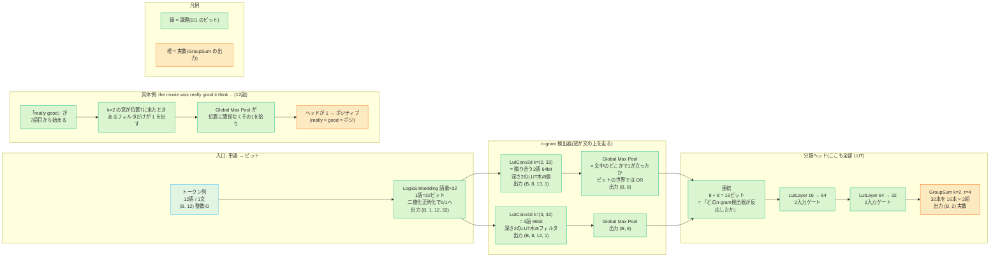
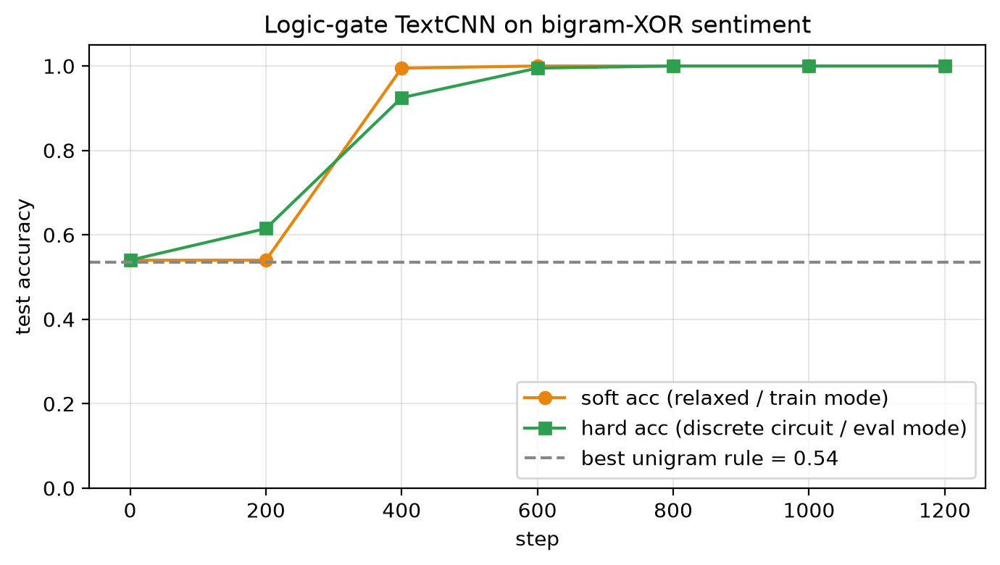
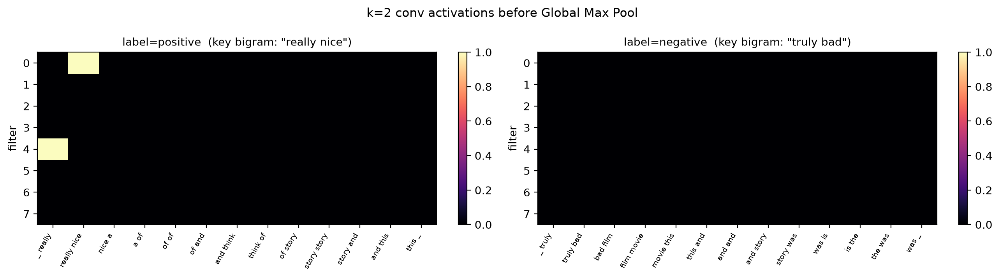
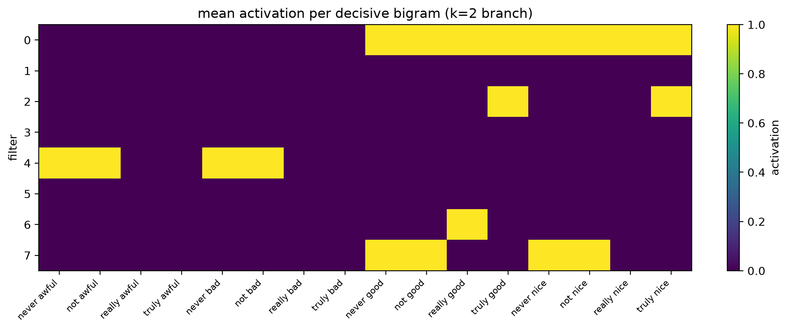

<!-- このファイルは scripts/build_tutorials.py が自動生成しています。
     直接編集せず、examples/23_textcnn.py を編集して再生成してください。 -->

**単語を数えるだけでは絶対に解けない**問題を用意して、畳み込みが n-gram 検出器として
働くことを反証不能な形で示す。肯定語 × 良い語 / 否定語 × 悪い語 の XNOR でラベルを
決めるバイグラム XOR 分類では、どの単語も両クラスに等頻度で現れる ──
つまり**ユニグラムの情報量がゼロ**(単語頻度による規則の上限 0.535 = ほぼ偶然)。

論理ゲート版 TextCNN はこれを soft/hard ともに **1.000** で解く。しかも学習後の
フィルタを覗くと、filter 6 は "really good"、filter 4 は "never awful" ──
**特定の2語の検出器**へ育っている。[付録: XOR](/tutorials/xor/) の自然な続き。

:::tip[このページで学ぶこと]
1. 単語頻度では原理的に解けない課題(バイグラム XOR 分類)の作り方と、その意味
2. 論理ゲート版 TextCNN の構成と、soft/hard ともに 1.000 で解けること
3. 学習後のフィルタを覗いて「特定の2語の検出器」へ育っていることを確かめる方法

**前提**

- [付録: XORで仕組みを最小で覗く](/tutorials/xor/) — 同じ XOR 構造の最小版
- [1. MNISTを学習する](/tutorials/mnist/)
:::

:::note[このページについて]
所要時間の目安: **約5分** / 実行環境: CPU のみ(GPU 不要)
元スクリプト: [`examples/23_textcnn.py`](https://github.com/tsukushi-gate/Griffith/blob/main/examples/23_textcnn.py)
手元で試す: [`notebooks/23_textcnn.ipynb`](https://github.com/tsukushi-gate/Griffith/blob/main/notebooks/23_textcnn.ipynb)(このページと同じ内容の未実行ノートブック。`uv run --group docs jupyter lab notebooks/` で開ける)
コード出力はすべて **実際に実行した結果**をそのまま埋め込んでいます。
:::

<!-- Colabバッジ: リポジトリ public 化後、この span を data-colab-url を href に
     持つ <a> へ差し替えると「Colabで開く」が有効になる。 -->
<span class="colab-badge" data-colab-url="https://colab.research.google.com/github/tsukushi-gate/Griffith/blob/main/notebooks/23_textcnn.ipynb">▶ Colabで開く(リポジトリ公開後に有効化)</span>

TextCNN(論理ゲート版)でテキスト分類を学習し、畳み込みがn-gram検出器として
働く様子を可視化する例。

TextCNN(Kim 2014)は「埋め込み列の上を幅kの窓で畳み込み、Global Max Poolで
最も強く反応した位置だけを拾う」というモデルで、各フィルタは事実上
**「特定のn-gramが文中のどこかに出たか」を検出する回路**になる。
本サンプルはその畳み込みを LutConv2d(微分可能論理ゲートの木)で置き換えたもので、
埋め込みも LogicEmbedding によって {0,1} のビットベクトルへ落ちる。
つまり文全体が、乗算を1つも使わない論理回路で分類される。

**モデルはパッケージ内ではなく experiments/train_textcnn.py にある**

TextCNNModel は実験スクリプト側(パッケージ外)に置かれているため、
`from griffith_logic import ...` では取れない。ここでは tests/test_textcnn.py と
同じやり方で sys.path に experiments/ を足して import する。
(実験スクリプトの読み込み時に .env の読み込みと wandb ユーティリティの
 import が走るが、init_wandb を呼ばない限りログ送信は発生しない。)

**題材: バイグラムXOR**

本家は日本語感情分析データセット WRIME を使うが、ダウンロードと学習に時間がかかる。
ここでは数分で回るよう、**ユニグラムだけでは絶対に解けない**合成タスクを用意した:

    really good -> ポジティブ      not good  -> ネガティブ
    really bad  -> ネガティブ      not bad   -> ポジティブ

肯定語(really / truly)と否定語(not / never)、良い語(good / nice)と
悪い語(bad / awful)の組み合わせで、ラベルは2語のXORで決まる。
どの単語も両クラスに等頻度で現れるので、単語の出現頻度(=ユニグラム)を
いくら数えても精度50%より上には行かない。**隣り合う2語をセットで見る**しか
解く方法がなく、これはまさに幅2の畳み込みが得意とする形になっている。
例01のXORが、単語の世界へ引っ越してきたと思えばよい。

**回路の全体像(1文12語・埋め込み32ビットの実寸)**



**具体例が図としてどこに出るか**: 上の EX の流れは、このページ2枚目の図
「k=2 conv activations before Global Max Pool」で実物が見られる。
横軸が窓の位置、縦軸がフィルタ番号で、**決定的なバイグラムがある位置の列だけが光る**。
3枚目の図はそれを全テスト文で平均したもので、
「really good」「not bad」といった組み合わせごとに反応するフィルタが分かれていることが分かる。

**どう実現しているか**

- **埋め込みもビットにする**。LogicEmbedding は1語を32本のビット線に割り当てる。
  学習中は [0,1] の実数だが、正則化で 0/1 の両端へ押しやるので、最終的には
  「単語 = 32ビットの符号」になる
- **窓が埋め込み次元を丸ごと覆う**。kernel=(k, 32) と幅を埋め込み次元に一致させるので
  横方向の出力幅が1になり、2次元畳み込みがそのまま1次元の n-gram 走査になる
- **1フィルタ = 1つの n-gram 検出回路**。k=2 なら 2語×32ビット = 64本を見て 0/1 を返す
  LUT の木。「really の符号かつ good の符号なら1」といった論理を、表として学習する
- **Global Max Pool は OR**。ビットの世界では max = OR なので、
  「文中のどこかでその n-gram が出たか」を、位置を捨てて1ビットに畳み込める。
  これが TextCNN が語順に強く位置に鈍い理由でもある
- **ユニグラムでは50%が上限**。どの単語も両クラスに等頻度で出るので、
  単語の出現を数えるだけの回路は原理的に解けない。**隣り合う2語をセットで見る**
  = 幅2の窓が必要、という構造がこのタスクの本質である

実行: uv run python examples/23_textcnn.py
期待結果: hard accuracy 1.00(CPUで約1分)

## 準備: import と乱数種

モデル本体 `TextCNNModel` は `experiments/train_textcnn.py` にあり、パッケージ外なので
`sys.path` を通してから読み込む。ゲートの初期接続も埋め込みもランダム初期化なので、
再現性のために PyTorch と Python 標準の乱数の両方を固定する。

```python
import os
import random
import sys

import matplotlib.pyplot as plt
import torch
import torch.nn.functional as F
```

```python
# experiments/ はパッケージ外なので、sys.path に足してから import する
# (tests/test_textcnn.py と同じ手口)。
# ノートブックでは __file__ が未定義なので、その場合はカレントディレクトリを
# リポジトリルートとみなす(examples はリポジトリルートから実行する規約)。
_REPO_ROOT = (
    os.path.dirname(os.path.dirname(os.path.abspath(__file__)))
    if '__file__' in globals()
    else os.getcwd()
)
sys.path.insert(0, os.path.join(_REPO_ROOT, 'experiments'))
from train_textcnn import TextCNNModel  # noqa: E402
```

```python
# ゲートの初期接続も埋め込みもランダム初期化なので、再現性のため固定する。
SEED = 0
torch.manual_seed(SEED)
rng = random.Random(SEED)
```

### ハイパーパラメータ

**n-gram** とは「連続する n 語のまとまり」のこと(2語なら**バイグラム**)。
`KERNELS = [2, 3]` は「幅2の窓と幅3の窓を並べて走らせる」という意味で、
答えがバイグラムにあるこのタスクでは k=2 のブランチが主役になる。
`D_EMB` は1語を何本のビット線で表すかで、ここでは1語 = 32 ビットの符号になる。

```python
SEQ_LEN = 12      # 1文のトークン数(短いほど速い)
N_TRAIN = 600     # 訓練文数
N_TEST = 200      # 評価文数
D_EMB = 32        # LogicEmbeddingの次元(= 1トークンあたりのビット数)
N_FILTERS = 8     # ブランチあたりのフィルタ数
KERNELS = [2, 3]  # n-gram幅。答えはバイグラムにあるので k=2 が主役
STEPS = 1200      # 学習イテレーション数
BATCH = 32
LR = 0.01
```

## データ: ユニグラムでは絶対に解けない題材を作る

ラベルは「修飾語 × 意味語」の XOR で決まる ── `really good` と `not bad` がポジティブ、
`not good` と `really bad` がネガティブ。**どの単語も両クラスに等頻度で現れる**ように
作ってあるので、単語の出現頻度(= **ユニグラム**、1語だけを見る特徴)をいくら数えても
精度は 50% を超えられない。

**なぜこの題材を選ぶのか**: 「隣り合う2語をセットで見る」以外に解法が存在しない状況を
人工的に作ることで、学習後に精度が上がっていれば**畳み込みが本当に n-gram を
捉えた証拠になる**からである。例01の XOR が、単語の世界へ引っ越してきたと思えばよい。

```python
# 肯定語 x 良い語 = ポジ、否定語 x 悪い語 = ポジ、というXOR構造。
AFFIRM = ['really', 'truly']    # 肯定の修飾語
NEGATE = ['not', 'never']       # 否定の修飾語
GOOD = ['good', 'nice']         # 良い意味の語
BAD = ['bad', 'awful']          # 悪い意味の語
```

```python
# 意味を持たない埋め草。ラベルとは無相関にする。
FILLER = ['the', 'movie', 'was', 'i', 'think', 'it', 'and', 'story',
          'is', 'this', 'film', 'a', 'of', 'to', 'that', 'seemed']
```

```python
def make_sentence():
    """1文を作り、(トークン列, ラベル, バイグラムの開始位置) を返す。

    ラベル = 1(ポジ) は「肯定語+良い語」か「否定語+悪い語」のとき。
    どちらの修飾語もどちらの意味語も、ポジ・ネガに等確率で現れる。
    """
    modifier_is_affirm = rng.random() < 0.5
    word_is_good = rng.random() < 0.5
    modifier = rng.choice(AFFIRM if modifier_is_affirm else NEGATE)
    word = rng.choice(GOOD if word_is_good else BAD)
    # XNOR: 肯定x良い → ポジ、否定x悪い → ポジ、それ以外はネガ
    label = int(modifier_is_affirm == word_is_good)

    tokens = [rng.choice(FILLER) for _ in range(SEQ_LEN - 2)]
    start = rng.randrange(0, SEQ_LEN - 1)   # バイグラムを差し込む位置
    tokens = tokens[:start] + [modifier, word] + tokens[start:]
    return tokens[:SEQ_LEN], label, start
```

```python
def make_dataset(n):
    sents, labels, starts = [], [], []
    for _ in range(n):
        s, y, st = make_sentence()
        sents.append(s)
        labels.append(y)
        starts.append(st)
    return sents, labels, starts
```

```python
train_sents, train_labels, _ = make_dataset(N_TRAIN)
test_sents, test_labels, test_starts = make_dataset(N_TEST)
```

### 語彙とID化

単語を整数 ID へ写す辞書を作る。埋め込み層はこの ID を引いてビット列を返すので、
ここが「文字列の世界」と「回路の世界」の境目になる。

```python
# 0 はパディング用に空けておく(このサンプルでは全文が同じ長さなので実際には使わない)。
vocab = sorted({w for s in train_sents + test_sents for w in s})
stoi = {w: i + 1 for i, w in enumerate(vocab)}
itos = {i: w for w, i in stoi.items()}
VOCAB_SIZE = len(stoi) + 1
```

```python
def encode(sents):
    return torch.tensor([[stoi[w] for w in s] for s in sents])
```

```python
train_x, train_y = encode(train_sents), torch.tensor(train_labels)
test_x, test_y = encode(test_sents), torch.tensor(test_labels)
print(f'train={tuple(train_x.shape)} test={tuple(test_x.shape)} '
      f'語彙={VOCAB_SIZE}語 / 2クラス')
```

```text title="出力"
train=(600, 12) test=(200, 12) 語彙=25語 / 2クラス
```

### ユニグラムの上限を先に測っておく

「良い語を含むならポジ」という**最良のユニグラム規則**を実際に走らせ、その精度を控えておく。
あとで学習曲線にこの値を破線で引き、**そこからの伸びぶんが n-gram の寄与**だと読めるようにする。
主張を先に測っておくと、結果を「たまたま上がった」と混同せずに済む。

```python
good_ids = {stoi[w] for w in GOOD}
unigram_pred = torch.tensor(
    [int(any(int(t) in good_ids for t in row)) for row in test_x]
)
unigram_acc = (unigram_pred == test_y).float().mean().item()
print(f'ユニグラム規則(良い語を含めばポジ)の精度={unigram_acc:.3f} '
      f'← 偶然と同じ。単語を数えるだけでは解けない')
```

```text title="出力"
ユニグラム規則(良い語を含めばポジ)の精度=0.535 ← 偶然と同じ。単語を数えるだけでは解けない
```

## モデル: 論理ゲート版 TextCNN

構成は `LogicEmbedding` → 各 k の `LutConv2d` ブランチ → Global Max Pool → 連結 →
`LutLayer` スタック → `GroupSum`。要点は3つある。

- **埋め込みもビットにする**。`LogicEmbedding` は1語を32本のビット線へ割り当てる。
  学習中は [0,1] の実数だが、正則化で 0/1 の両端へ押しやるので、最終的には
  「単語 = 32ビットの符号」になる
- **窓が埋め込み次元を丸ごと覆う**。`kernel_size=(k, d_emb)` と幅を埋め込み次元に
  一致させるので横方向の出力幅が1になり、2次元畳み込みがそのまま**1次元の n-gram 走査**になる。
  1フィルタ = 「2語×32ビット = 64本を見て 0/1 を返す LUT の木」= **1つの n-gram 検出回路**である
- **Global Max Pool は OR**。ビットの世界では max は「どれか1つでも1なら1」= OR に一致する。
  **なぜ max pooling が OR なのか**が効いてくるのはここで、位置を捨てて
  「文中のどこかでその n-gram が出たか」を1ビットに畳み込める。比較器も加算器も要らない

```python
# TextCNNModel の構造:
#   LogicEmbedding → 各kのLutConv2dブランチ → Global Max Pool
#   → 連結 → LutLayerスタック → GroupSum
# LutConv2d を kernel_size=(k, d_emb) で使うのがポイントで、
# 埋め込み次元を丸ごと覆うため出力幅が1になり、実質的な1次元畳み込みになる。
model = TextCNNModel(
    vocab_size=VOCAB_SIZE,
    d_emb=D_EMB,
    n_filters=N_FILTERS,
    kernel_sizes=KERNELS,
    dense_dims=[64, 32],
    n_classes=2,
    tree_depth=2,     # 各フィルタは深さ2のゲート木(= 4入力ぶんの論理関数)
    n_inputs=2,       # 2入力ゲート
    device='cpu',
)
print(model)
```

```text title="出力"
TextCNNModel(
  (embedding): LogicEmbedding(
    (embedding): Embedding(25, 32)
  )
  (branches): ModuleList(
    (0): LutConv2d(in_channels=1, out_channels=8, kernel_size=(2, 32), tree_depth=2, stride=(1, 1), padding=(1, 0), n_inputs=2, n_leaves=4, n_internal=3, input_ch_per_tree=1, param=softmax)
    (1): LutConv2d(in_channels=1, out_channels=8, kernel_size=(3, 32), tree_depth=2, stride=(1, 1), padding=(1, 0), n_inputs=2, n_leaves=4, n_internal=3, input_ch_per_tree=1, param=softmax)
  )
  (dense_layers): ModuleList(
    (0): LutLayer(in=16, out=64, n_inputs=2, entries=4, param=softmax/16gate)
    (1): LutLayer(in=64, out=32, n_inputs=2, entries=4, param=softmax/16gate)
  )
  (group_sum): GroupSum(k=2, tau=4.0)
)
```

## 学習: 分類の損失に埋め込みの二値化正則化を足す

損失は cross entropy に `emb_reg`(**埋め込みを 0/1 へ寄せる正則化**)を少し混ぜたもの。
**なぜ必要か**: 推論時に `LogicEmbedding` は Heaviside(閾値で 0/1 に切る階段関数)で
二値化されるので、学習中の実数値が中途半端なままだと、離散化した瞬間に符号が変わって
hard accuracy だけ崩れる。正則化で先に両端へ寄せておくことで、soft と hard が一致する。
精度も `soft`(連続緩和のまま)と `hard`(離散化した回路)の両方で測る。

```python
# forward が (logits, emb_reg_loss) の2値を返すのが TextCNNModel の作法。
# emb_reg_loss は「埋め込みを0/1へ寄せる」正則化で、
# 推論時に LogicEmbedding が Heaviside で二値化されても壊れないようにする役目。
opt = torch.optim.AdamW(model.parameters(), lr=LR, weight_decay=0.001)
history = []  # (step, soft acc, hard acc)
```

```python
@torch.no_grad()
def accuracy(train_mode):
    """soft(train mode=連続緩和) / hard(eval mode=離散化した回路) の精度。"""
    was_training = model.training
    model.train(mode=train_mode)
    logits, _ = model(test_x)
    acc = (logits.argmax(-1) == test_y).float().mean().item()
    model.train(mode=was_training)
    return acc
```

```python
for step in range(STEPS + 1):
    if step % 200 == 0:
        soft_acc = accuracy(train_mode=True)
        hard_acc = accuracy(train_mode=False)
        history.append((step, soft_acc, hard_acc))
        print(f'step {step:>5}  soft acc={soft_acc:.4f}  hard acc={hard_acc:.4f}')

    idx = torch.randint(0, N_TRAIN, (BATCH,))
    logits, emb_reg = model(train_x[idx])
    # 埋め込みの二値化正則化を少しだけ混ぜる(重みは本家のランプの終端値あたり)。
    loss = F.cross_entropy(logits, train_y[idx]) + 0.05 * emb_reg
    opt.zero_grad()
    loss.backward()
    opt.step()

steps, soft_hist, hard_hist = zip(*history, strict=True)
final_soft, final_hard = soft_hist[-1], hard_hist[-1]
print(f'\n最終 soft acc={final_soft:.4f} / hard acc={final_hard:.4f}')
print(f'ユニグラム上限={unigram_acc:.4f} → 回路はバイグラムを見つけている')
assert final_hard > 0.85, f'hard acc={final_hard:.4f} が低すぎる'
```

```text title="出力"
step     0  soft acc=0.5400  hard acc=0.5400

step   200  soft acc=0.5400  hard acc=0.6150

step   400  soft acc=0.9950  hard acc=0.9250

step   600  soft acc=1.0000  hard acc=0.9950

step   800  soft acc=1.0000  hard acc=1.0000

step  1000  soft acc=1.0000  hard acc=1.0000

step  1200  soft acc=1.0000  hard acc=1.0000

最終 soft acc=1.0000 / hard acc=1.0000
ユニグラム上限=0.5350 → 回路はバイグラムを見つけている
```

## 畳み込みの中を覗く

ここからは「解けた」で終わらせず、**回路が何を見て解いたのか**を確かめる。
`TextCNNModel.forward` は Global Max Pool 済みの値しか返さないので、プール前の活性
(窓の位置ごとの 0/1)を自分で取り出す。やっていることは forward の前半と同じである。

```python
# TextCNNModel.forward は Global Max Pool 済みの値しか返さないので、
# 途中(プール前)の活性を自分で取り出す。やっていることは forward の前半と同じ。
@torch.no_grad()
def branch_activations(tokens, branch_idx):
    """指定ブランチのプール前活性を返す。

    Returns:
        (B, n_filters, H_out) — H_out は窓の位置数
    """
    model.eval()   # 埋め込みもゲートも離散化した「回路そのもの」を見る
    emb = model.embedding(tokens)          # (B, L, d_emb)
    h = model.branches[branch_idx](emb.unsqueeze(1))   # (B, n_filters, H_out, 1)
    return h.squeeze(-1)
```

```python
# k=2 のブランチが主役。padding=(k//2, 0) なので、出力位置 p の窓は
# 入力トークン [p - 1, p] を覆う(p=0 の窓は左のパディングとトークン0)。
K2_BRANCH = KERNELS.index(2)
PAD2 = 2 // 2
```

## 可視化: 学習曲線とフィルタの中身

### 図1: 学習曲線

**この図で何を見るか**: 橙が soft(連続緩和のまま)、緑が hard(離散化した論理回路)、
灰の破線が先ほど測ったユニグラム規則の上限。見どころは
**緑が灰の破線をはっきり超えること**で、超えた分がそのまま n-gram の寄与になる。

```python
fig, ax = plt.subplots(figsize=(7, 4))
ax.plot(steps, soft_hist, 'o-', color='#e8850c',
        label='soft acc (relaxed / train mode)')
ax.plot(steps, hard_hist, 's-', color='#2e9e4f',
        label='hard acc (discrete circuit / eval mode)')
ax.axhline(unigram_acc, ls='--', color='#888888',
           label=f'best unigram rule = {unigram_acc:.2f}')
ax.set_xlabel('step')
ax.set_ylabel('test accuracy')
ax.set_ylim(0, 1.05)
ax.grid(alpha=0.3)
ax.legend(loc='lower right')
ax.set_title('Logic-gate TextCNN on bigram-XOR sentiment')
fig.tight_layout()
plt.show()
```

    

    

**読み取り**: soft と hard がほぼ重なったまま伸び、ユニグラム上限(灰の破線)を大きく
超える。**離散化しても壊れない回路のまま**、単語を数えるだけでは届かない領域へ
到達したということ。soft だけ高く hard が置いていかれる場合は、
埋め込みかゲートが中間状態に居座っているサインになる(ここではそうなっていない)。

### 図2: フィルタが文のどこで発火しているか

**この図で何を見るか**: 縦がフィルタ番号、横が窓の位置(その窓が覆う2語をラベルにしてある)。
ポジ1文・ネガ1文について、プール前の活性をそのまま並べた。見どころは
**決め手のバイグラムがある位置の列だけが光る**こと ── それが「畳み込みがその2語を
検出器として捉えた」証拠になる。なお Global Max Pool は各行の最大値だけを後段へ渡すので、
分類に効くのは「どこで光ったか」ではなく「どこかで光ったか」だけである。

```python
examples = []
for want in (1, 0):   # ポジ1文・ネガ1文
    i = next(j for j in range(N_TEST) if test_labels[j] == want)
    examples.append(i)

fig, axes = plt.subplots(1, 2, figsize=(13, 3.6))
for ax, i in zip(axes, examples, strict=True):
    acts = branch_activations(test_x[i:i + 1], K2_BRANCH)[0]   # (n_filters, H_out)
    im = ax.imshow(acts.numpy(), aspect='auto', cmap='magma', vmin=0, vmax=1)
    # 出力位置 p のラベルは、その窓が覆う2語にする。
    labels = []
    for p in range(acts.shape[1]):
        lo, hi = p - PAD2, p - PAD2 + 1
        words = [itos[int(test_x[i, t])] if 0 <= t < SEQ_LEN else '_'
                 for t in (lo, hi)]
        labels.append(' '.join(words))
    ax.set_xticks(range(acts.shape[1]))
    ax.set_xticklabels(labels, rotation=60, ha='right', fontsize=7)
    ax.set_yticks(range(N_FILTERS))
    ax.set_ylabel('filter')
    key = ' '.join(test_sents[i][test_starts[i]:test_starts[i] + 2])
    ax.set_title(f'label={"positive" if test_labels[i] else "negative"}'
                 f'  (key bigram: "{key}")', fontsize=10)
    fig.colorbar(im, ax=ax, fraction=0.03)
fig.suptitle('k=2 conv activations before Global Max Pool', fontsize=11)
fig.tight_layout()
plt.show()
```

    

    

**読み取り**: 光っている列が、その文の決め手のバイグラム(タイトルの key bigram)の
位置と一致していることを確かめる。位置がばらばらの2文で同じフィルタが反応していれば、
そのフィルタは**位置ではなく語の組み合わせ**を見ているということ。
全く光らない行があるのも普通で、それは次の図で「死んだフィルタ」として数える。

### 図3: どのフィルタがどのバイグラムに反応するか

**この図で何を見るか**: 決め手の組み合わせ(`really good` / `not good` / `really bad` /
`not bad` の系統)ごとに、そのバイグラムが置かれた位置での活性をテストセット全体で平均した表。
縦がフィルタ、横がバイグラム。見どころは**行ごとに光る列が分かれること**で、
分かれていれば各フィルタが特定の n-gram の検出器へ育ったことになる。
逆に全列が同じ明るさの行は、何も見分けていない「死んだフィルタ」である。

```python
key_bigrams = {}
for i in range(N_TEST):
    st = test_starts[i]
    name = ' '.join(test_sents[i][st:st + 2])
    acts = branch_activations(test_x[i:i + 1], K2_BRANCH)[0]   # (n_filters, H_out)
    p = st + PAD2                                  # そのバイグラムを覆う出力位置
    key_bigrams.setdefault(name, []).append(acts[:, p])

names = sorted(key_bigrams, key=lambda n: (n.split()[1], n.split()[0]))
matrix = torch.stack([torch.stack(key_bigrams[n]).mean(0) for n in names], dim=1)

fig, ax = plt.subplots(figsize=(max(7, 0.62 * len(names)), 4.2))
im = ax.imshow(matrix.numpy(), aspect='auto', cmap='viridis', vmin=0, vmax=1)
ax.set_xticks(range(len(names)))
ax.set_xticklabels(names, rotation=45, ha='right', fontsize=8)
ax.set_yticks(range(N_FILTERS))
ax.set_ylabel('filter')
ax.set_title('mean activation per decisive bigram (k=2 branch)')
fig.colorbar(im, ax=ax, fraction=0.03, label='activation')
fig.tight_layout()
plt.show()
```

    

    

**読み取り**: 上の表を行ごとに読み下すと、フィルタが「どのバイグラムの検出器になったか」が
言葉で出てくる。「最大 − 最小」の差が大きいフィルタほど選択的で、差がほぼ 0 の行は
どのバイグラムでも同じ値を返す**死んだフィルタ**である。冗長に用意したフィルタの一部が
こうなるのは普通のことで、Global Max Pool の後段は生きているフィルタだけを使えばよい。

```python
# 各フィルタが最も強く反応したバイグラムを表示する。
# 「最大 - 最小」が大きいフィルタほど、特定のバイグラムだけに反応する
# 選択的な検出器になっている。差がほぼ0のフィルタは、どのバイグラムでも
# 同じ値を返す = 何も見分けていない死んだフィルタで、
# 冗長に用意したフィルタの一部がこうなるのは普通のこと
# (Global Max Pool の後段が、生きているフィルタだけを使えばよいため)。
print('\nフィルタごとの最反応バイグラム:')
n_dead = 0
for f in range(N_FILTERS):
    row = matrix[f]
    best = int(row.argmax())
    spread = float(row[best] - row.min())
    if spread < 1e-3:
        n_dead += 1
        print(f'  filter {f}: 反応なし(全バイグラムで {row[best]:.3f} — '
              f'死んだフィルタ)')
    else:
        print(f'  filter {f}: "{names[best]}" (activation={row[best]:.3f}, '
              f'最小={row.min():.3f} → 差={spread:.3f})')
print(f'選択的なフィルタ {N_FILTERS - n_dead}/{N_FILTERS} 個で hard acc='
      f'{final_hard:.4f} を達成')
```

    
```text title="出力"
フィルタごとの最反応バイグラム:
  filter 0: "never good" (activation=1.000, 最小=0.000 → 差=1.000)
  filter 1: 反応なし(全バイグラムで 0.000 — 死んだフィルタ)
  filter 2: "truly good" (activation=1.000, 最小=0.000 → 差=1.000)
  filter 3: 反応なし(全バイグラムで 0.000 — 死んだフィルタ)
  filter 4: "never awful" (activation=1.000, 最小=0.000 → 差=1.000)
  filter 5: 反応なし(全バイグラムで 0.000 — 死んだフィルタ)
  filter 6: "really good" (activation=1.000, 最小=0.000 → 差=1.000)
  filter 7: "never good" (activation=1.000, 最小=0.000 → 差=1.000)
選択的なフィルタ 5/8 個で hard acc=1.0000 を達成
```

## 次に読む

- [付録: XORで仕組みを最小で覗く](/tutorials/xor/) — このページのXOR構造を4サンプルまで縮めて見る
- [論理ゲートGPT](/tutorials/logic-gpt/) — 分類ではなく生成をやる
- [因果convolutionを論理ゲートで](/tutorials/logic-wavenet/) — 同じ1次元畳み込みを系列予測へ
